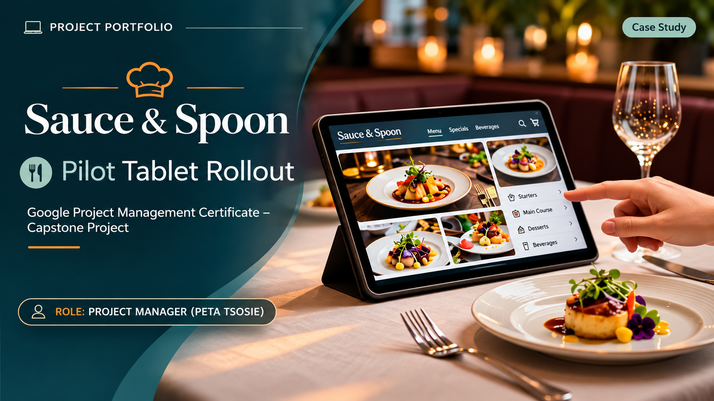
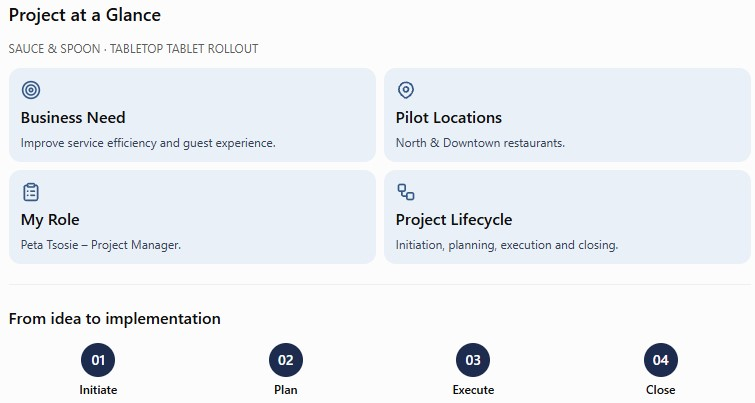

# Sauce & Spoon – Tablet Rollout Project

## Project Overview
This project is a capstone case study completed as part of the **Google Project Management Certificate**. It focuses on planning a pilot rollout of tabletop menu tablets across two Sauce & Spoon restaurant locations.

## My Role
In here, I worked as Peta, the newly hired Project Manager of Sauce & Spoon, leading the pilot launch of tabletop menu tablets in two restaurant locations. Join me as I embark on this project.

## Project Objectives
- Improve customer ordering and dining experience.
- Streamline restaurant operations and order management.
- Evaluate the pilot implementation and identify opportunities for improvement.

## Project Management Activities
- **Initiation:** Project charter, SMART goals and stakeholder analysis.
- **Planning:** Task breakdown, project timeline, quality planning and evaluation criteria.
- **Execution:** Pilot implementation approach, staff training and customer feedback.
- **Closing:** Project retrospective, lessons learned and project closeout report.

## Key Learnings
Applied project management concepts in planning, stakeholder engagement, scheduling, quality management, communication and continuous improvement.

## About Me
I have a background in Manufacturing Engineering and am developing my project management skills to support my career growth towards project management roles.

# SAUCE & SPOON
### Tabletop Tablet Rollout

## Project at a Glance

**PROJECT CASE STUDY** · Google Project Management Certificate – Capstone Project

---

| PROJECT DETAILS | |
|---|---|
| **Role** | Peta Tsosie – Project Manager |
| **Project Type** | Pilot Implementation |
| **Locations** | North & Downtown |
| **Focus** | Planning & Delivery |

---

## Project Journey
*Follow the project from initiation to closure.*

| | PROJECT STAGE | WHAT'S INCLUDED |
|---|---|---|
| **01** | [Introduction](01-Introduction/) | Project background and my role |
| **02** | [Project Overview](02-Project-Overview/) | Business need, purpose and objectives |
| **03** | [Project Initiation](03-Project-Initiation/) | Project charter, SMART goals and stakeholder analysis |
| **04** | [Project Planning](04-Project-Planning/) | Task brainstorm, timeline, quality plan and customer survey |
| **05** | [Project Execution](05-Project-Execution/) | Tablet implementation, training and test launch |
| **06** | [Project Closing](06-Project-Closing/) | Retrospective and project closeout report |
| **07** | [Personal Closing Report](08-Personal-Closing-Report/) | Lessons learned, accomplishments and future goals |

---

## About This Project

This capstone demonstrates the application of project management principles across the project lifecycle, from initiation and planning through execution and closure.

**Note:** This is a simulated project completed as part of the Google Project Management Certificate.
